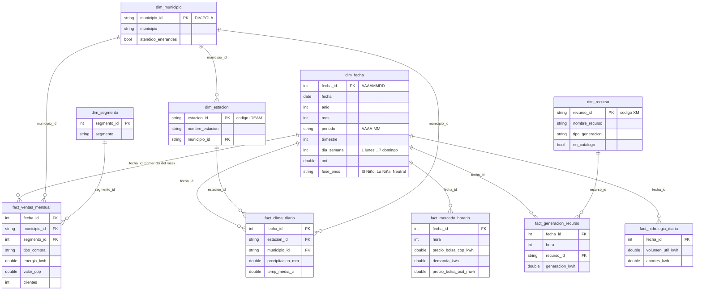
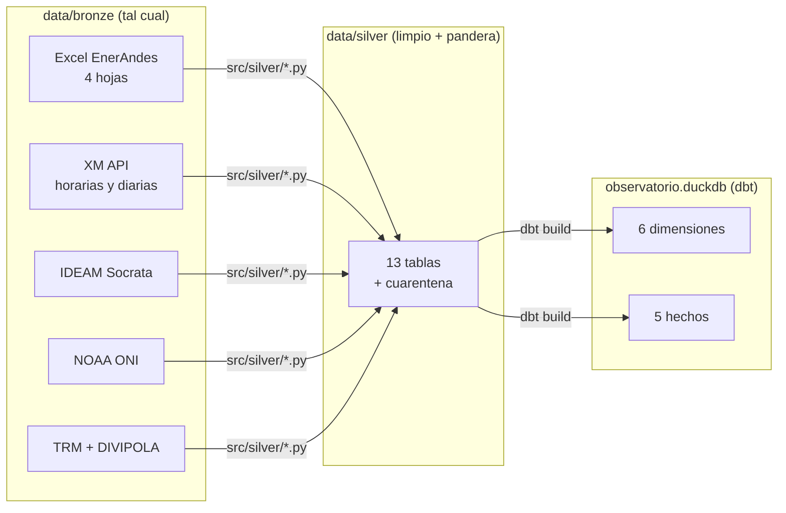

# Modelo dimensional - capa oro

La capa oro es un **esquema estrella** construido con dbt sobre DuckDB
(`dbt/models/marts/`, base `data/observatorio.duckdb`). Tiene **5 tablas de hechos** y
**6 dimensiones**. Se construye con `python -m src.transformar`, que limpia la capa
plata y ejecuta `dbt build`. `dbt build` crea las tablas y corre las pruebas
(`unique` y `not_null` en las llaves de las dimensiones, `relationships` en las llaves
de los hechos y `grano_unico` en el grano de cada hecho).

## Diagrama

## Grano de cada tabla de hechos

El **grano** dice qué representa exactamente una fila. Es la primera decisión del diseño:
define qué medidas se pueden sumar y con qué dimensiones se puede cruzar el hecho.

| Hecho | Grano (una fila es...) | Periodo | Filas | Medidas |
|---|---|---|---:|---|
| `fact_ventas_mensual` | un **mes** x **municipio** x **segmento** x **tipo de compra** de EnerAndes | 2023-01 a 2026-09 | 4.007 | `energia_kwh`, `valor_cop`, `clientes`, `tarifa_media_cop_kwh`, `consumo_por_cliente_kwh` |
| `fact_mercado_horario` | una **fecha** x **hora** del Sistema Interconectado Nacional | 2023-01-01 a 2026-09-30 | 32.856 | `precio_bolsa_cop_kwh`, `demanda_kwh`, `trm_cop_usd`, `precio_bolsa_usd_mwh` |
| `fact_generacion_recurso` | una **fecha** x **hora** x **planta** con generación reportada | 2023-01-01 a 2026-09-30 | 7.593.479 | `generacion_kwh` |
| `fact_hidrologia_diaria` | una **fecha** para todo el SIN | 2023-01-01 a 2026-09-30 | 1.369 | `volumen_util_kwh`, `aportes_kwh` |
| `fact_clima_diario` | una **fecha** x **estación** del IDEAM en Antioquia | 2023-01-01 a 2026-07-31 (el IDEAM no tiene datos posteriores) | 38.720 | `precipitacion_mm`, `temp_media_c`, `temp_min_c`, `temp_max_c` |

Notas sobre el grano:

- **`fact_ventas_mensual`**: el Excel de EnerAndes reporta por mes, no por día. Para unirlo
  a `dim_fecha`, que es diaria, cada mes se representa con su primer día (`2024-03 -> 20240301`).
  Por eso, para cruzar ventas con hechos diarios u horarios se agrega primero por
  `dim_fecha.periodo` (ver `consultas/oro/02_exposicion_enerandes_a_bolsa.sql`).
  `tipo_compra` (Bolsa o Contrato) es una dimensión degenerada: tiene solo dos valores y
  no tiene atributos propios, por eso queda como columna del hecho.
- **`fact_mercado_horario`**: el precio de bolsa y la demanda tienen el mismo grano
  (fecha y hora del sistema), por eso van en un solo hecho. La TRM es diaria y se repite
  en las 24 horas del día para calcular el precio en USD/MWh.
- **`fact_generacion_recurso`**: solo tiene las horas en que la planta reportó generación.
  XM deja la hora vacía cuando la planta no generó (por ejemplo, las solares de noche), y
  esas horas no se convierten en 0. Las 14 plantas que generan pero no están en
  `ListadoRecursos` existen en `dim_recurso` con `en_catalogo = false`, para no perder su energía.
- **`fact_hidrologia_diaria`**: los embalses y los ríos son diarios. Se suman para todo el SIN
  porque la pregunta del reto es sistémica: ¿hay agua para generar?
- **`fact_clima_diario`**: la precipitación y la temperatura se miden en estaciones, y una
  estación puede medir solo una de las dos (columnas vacías). `municipio_id` viene de
  `dim_estacion` y se repite en el hecho para filtrar por municipio sin pasar por la estación.

## Dimensiones

| Dimensión | Una fila es... | Llave | Origen |
|---|---|---|---|
| `dim_fecha` | un día de 2023-01-01 a 2026-12-31 | `fecha_id` (AAAAMMDD) | generada en dbt + `noaa_oni_mensual` (fase ENSO del mes) |
| `dim_municipio` | un municipio de Antioquia | `municipio_id` (DIVIPOLA) | `divipola_municipios` (DANE) |
| `dim_segmento` | un segmento de cliente | `segmento_id` | `enerandes_ventas` |
| `dim_recurso` | una planta de generación | `recurso_id` (código XM) | `xm_recursos` (ListadoRecursos) + plantas sin catálogo |
| `dim_estacion` | una estación del IDEAM | `estacion_id` | `ideam_estaciones` |

`dim_fecha` es una **dimensión conformada**: la comparten los 5 hechos, y por eso se pueden
cruzar ventas, precio, generación, hidrología y clima por día, mes o fase ENSO.
`dim_municipio` también es conformada: la usan las ventas y el clima.

## Flujo de datos

